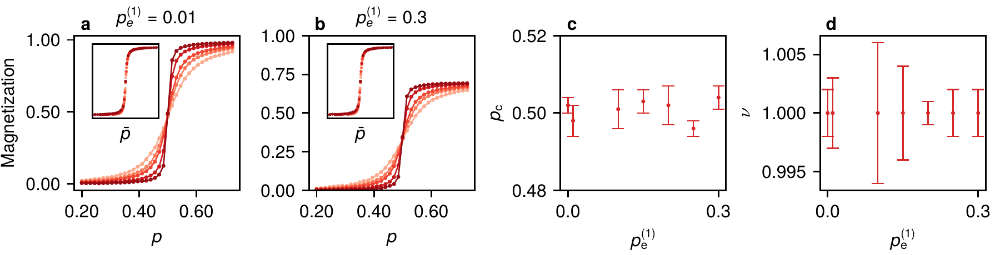
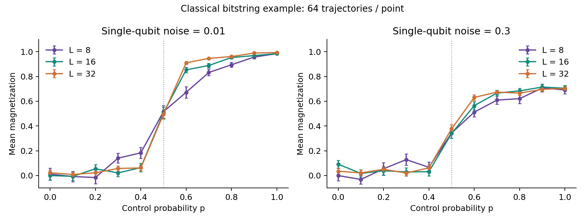
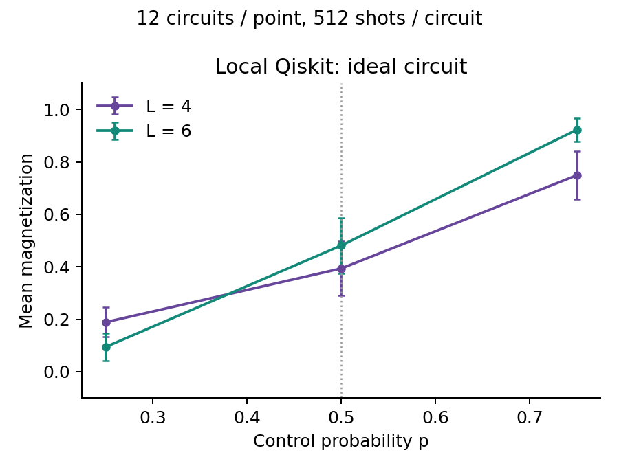
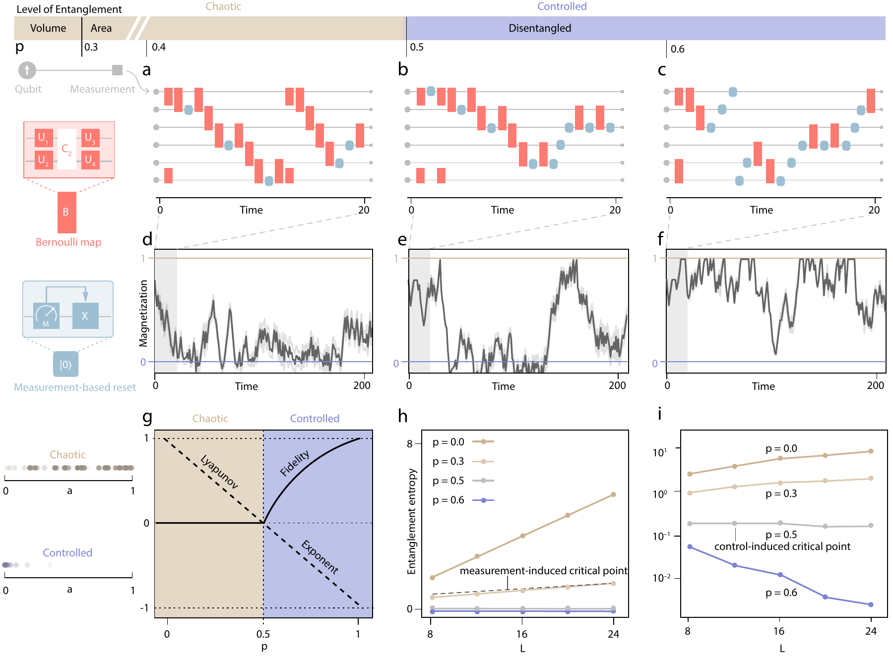
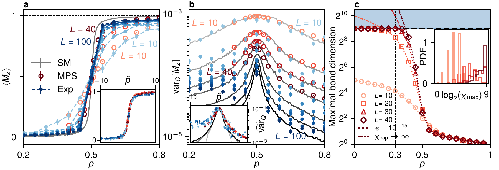

# Control Transition: Adaptive Circuits and Classical Noise

[](https://github.com/ka784-jpg/Control-Transition/actions/workflows/tests.yml)
[](LICENSE)

Simulation code for competition between scrambling and measurement-based control.
Two complementary workflows are included: **Julia bitstring trajectories with
depolarizing noise** and **Python/Qiskit circuits with resets and local simulation**.
The repository presents Kemal Aziz's simulation contributions, not the complete
experimental control or analysis software of the collaboration.

**Paper:** Bibek Pokharel, Haining Pan, Kemal Aziz, Luke C. G. Govia, Sriram
Ganeshan, Thomas Iadecola, Justin H. Wilson, Barbara A. Jones, Abhinav Deshpande,
Jedediah H. Pixley, and Maika Takita,
[*Order from chaos with adaptive circuits on quantum hardware*](https://arxiv.org/abs/2509.18259).

[Run an example](#quickstart) | [Paper figures](docs/RESULTS.md) | [Models and interfaces](docs/MODELS.md) | [Reproducibility](docs/REPRODUCIBILITY.md) | [Qiskit example](examples/qiskit_local.py)



**What the calculation probes.** Reset operations compete with local scrambling.
The figure shows the paper's noise analysis of magnetization and finite-size
scaling. It is **Figure 7 of arXiv:2509.18259v1**, in the supplemental material,
not a plot generated by the small example below.
[Figure details, original PDF, and code mapping](docs/RESULTS.md#figure-7-noise-analysis).

## Quickstart

### Classical Bitstring Simulation

Install [Julia 1.12](https://julialang.org/downloads/), then run from the repository root:

```sh
julia --project=. --startup-file=no examples/classical.jl results/classical
julia --project=. --startup-file=no tests/runtests.jl
```

No external Julia packages are needed for this example. It uses the original
classical update functions with seeded initial states and a bounded sweep:
L=8,16,32; 64 trajectories per point; 2L^2 operations. The driver saves CSV data
and metadata and refuses to overwrite an existing output directory.

```sh
python -m pip install -r examples/requirements.txt
python examples/plot.py results/classical results/classical/magnetization.png
```



[Saved data](examples/expected/classical/) | [Driver](examples/classical.jl).
The small sample illustrates the workflow; it does not fit critical exponents.

### Local Qiskit Simulation

Use Python 3.12 or newer, preferably in a virtual environment:

```sh
python -m pip install -r examples/requirements-qiskit.txt
python examples/qiskit_local.py results/qiskit
python examples/plot.py results/qiskit results/qiskit/magnetization.png
python -m unittest discover -s tests -p test_qiskit.py -v
```

This runs **locally on Aer**: no account, credentials, IBM hardware access, or
paid jobs. It samples L=4,6 circuits with resets, random single-qubit rotations,
and a randomly oriented CNOT. Each point uses 12 circuits and 512 shots each.
The example is noiseless; it does not imitate a particular device calibration.



[Saved counts and data](examples/expected/qiskit/) | [Circuit builder](examples/qiskit_local.py).

## Explore the Paper

| Protocol | Experimental context | Noise analysis |
| --- | --- | --- |
| [](docs/RESULTS.md#figure-1-protocol-context) | [](docs/RESULTS.md#figure-2-results-in-context) | [](docs/RESULTS.md#figure-7-noise-analysis) |

## Scope and Reliability

- The classical code tracks one bitstring per trajectory. It models diagonal
  probabilities and magnetization, not coherent wavefunctions or entanglement.
- The Qiskit example retains quantum amplitudes and Born-rule reset behavior.
  Its circuit-to-circuit error bars are distinct from the paper's specialized
  quantum-fluctuation estimators.
- Tests cover noise-channel probabilities, limiting cases, seeded repeatability,
  Born resets, input validation, source checksums, links, and output protection.
- Original files [Classical Noise Code](Classical%20Noise%20Code) and
  [Qiskit Code](Qiskit%20Code) remain byte-for-byte intact. Supported entry points
  are in `examples/`; the original Qiskit file uses legacy APIs.
- Small examples do not reproduce the complete hardware dataset, MPS calculations,
  or production finite-size fits. See [reproducibility](docs/REPRODUCIBILITY.md).

Code is [MIT licensed](LICENSE). Paper figures retain their separately documented
[attribution and license](docs/figures/README.md). Cite all paper coauthors.
